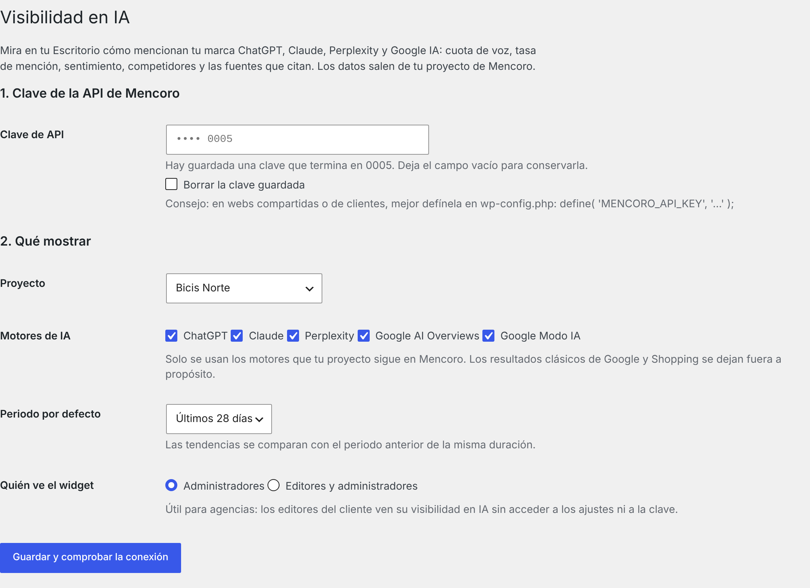

# AI Visibility Dashboard for Mencoro

**Descubre cómo hablan de tu marca ChatGPT, Claude, Perplexity y Google IA, sin salir del escritorio de WordPress.**

🇬🇧 **[Read in English](README.md)**

Plugin gratuito para WordPress que añade un widget de **Visibilidad en IA** al Escritorio, con los datos de tu proyecto de [Mencoro](https://mencoro.com/). Las métricas de GEO (optimización para motores generativos) suelen vivir en una herramienta aparte que nadie abre. Este plugin las pone donde el dueño de la web, sus editores y tus clientes ya miran cada día.

<p align="center"></p>

<sub>Captura con datos de ejemplo.</sub>

## Qué muestra

| | |
|---|---|
| **Cuota de voz** | Tu parte de las menciones de marca en las respuestas de IA, frente a los competidores que sigues. |
| **Tasa de mención** | De todas las respuestas de IA comprobadas, cuántas mencionan tu marca. |
| **Posición media** | En qué lugar de la respuesta apareces (cuanto más bajo, mejor). |
| **Positividad** | Tono de las menciones, de 0 a 100. |
| **Evolución** | Cuota de voz día a día (semana a semana en 90 días). |
| **Tú y tus competidores** | Cuota de voz comparada. |
| **Tono de las menciones** | Reparto entre positivas, neutras y negativas. |
| **Fuentes que cita la IA** | Los dominios en los que se apoyan las respuestas para tus temas. Tu web aparece marcada y, si no está, el widget te lo dice. |
| **Consultas que más se mueven** | Los prompts seguidos que más cuota de voz ganan y pierden. |

Cada cifra lleva su cambio respecto al periodo anterior de la misma duración (▲ mejora, ▼ empeora, siempre con número, nunca solo con color). Desde el propio widget cambias entre 7, 28 y 90 días.

Motores: ChatGPT, Claude, Perplexity, Google AI Overviews y Google Modo IA, los que siga tu proyecto en Mencoro. Los resultados clásicos de Google y Shopping se dejan fuera a propósito.

## Requisitos

- WordPress 6.5 o superior y PHP 7.4 o superior.
- Una cuenta de Mencoro con un proyecto y una **clave de API** (Mencoro → menú de usuario → *API keys*). Basta con el permiso `read` (lectura).

## Instalación

1. Descarga el zip de la última versión (o clona este repositorio en `wp-content/plugins/ai-visibility-dashboard`).
2. En WordPress, ve a **Plugins → Añadir nuevo → Subir plugin**, sube el zip y actívalo.
3. Entra en **Ajustes → Visibilidad en IA**, pega tu clave y pulsa **Guardar y comprobar la conexión**.
4. Elige tu proyecto, guarda y abre el **Escritorio**.

<p align="center"></p>

## Para agencias

- **Enséñaselo al cliente sin darle la clave.** En *Quién ve el widget*, elige *Editores y administradores*: los editores del cliente ven su visibilidad en IA, pero solo los administradores entran en los ajustes.
- **Saca la clave de la base de datos.** Defínela en `wp-config.php` y el campo desaparece de los ajustes:

  ```php
  define( 'MENCORO_API_KEY', 'mencoro_sk_…' );
  ```

  También vale una variable de entorno `MENCORO_API_KEY`.
- Una misma clave de Mencoro puede leer varias organizaciones: el selector agrupa los proyectos por organización, así que cada web de cliente apunta a su propio proyecto.

## Privacidad y seguridad

- El plugin solo se comunica con `api.mencoro.com`, con tu clave y con peticiones de **solo lectura**. Nunca crea, cambia ni borra nada en Mencoro.
- No envía nada sobre tu web ni tus visitantes, no añade nada a la parte pública y no carga scripts externos. El widget se genera en el servidor: cero JavaScript.
- La clave nunca se vuelve a mostrar en la página (solo sus cuatro últimos caracteres) y la opción que la guarda no se carga automáticamente.
- Los datos se guardan en caché 6 horas (Mencoro revisa casi todas las consultas una vez al día). Cada actualización hace 7 peticiones a la API; los errores se guardan 5 minutos para que una clave mala no sature la API.
- Al desinstalar se borran los ajustes, la clave y la caché.

## Para desarrolladores

| Hook / constante | Para qué sirve |
|---|---|
| `MENCORO_API_KEY` (constante o variable de entorno) | Clave de API; tiene prioridad sobre la guardada. |
| `aivd_widget_capability` (filtro) | Permiso necesario para ver el widget. Por defecto `manage_options`, o `edit_others_posts` si se permite a los editores. |
| `aivd_cache_ttl` (filtro) | Duración de la caché en segundos. Por defecto `6 * HOUR_IN_SECONDS`. |
| `aivd_api_base` (filtro) / `AIVD_API_BASE` (constante) | URL base de la API, por ejemplo para probar contra un servidor simulado. |

Rutas que usa (todas `GET`, ver la [documentación de la API de Mencoro](https://mencoro.com/api-docs/)): `me`, `organizations`, `projects`, `projects/{id}`, `available-filters`, `metrics`, `timeseries`, `cited-sources`, `metrics/movers`.

Normas de código: `phpcs --standard=phpcs.xml.dist` (WordPress-Extra + WordPress-Docs) pasa sin avisos.

## Traducciones

Incluye inglés y español de España. El dominio de texto es `ai-visibility-dashboard` y la plantilla `.pot` está en `languages/`. Se agradecen pull requests con nuevos idiomas.

## Licencia

GPL-2.0-or-later. Ver [LICENSE](LICENSE).

---

Hecho por [TrailSEO](https://trailseo.com/). Es un plugin independiente construido sobre la API pública de Mencoro; no es un producto oficial de Mencoro. Mencoro es una marca de sus respectivos propietarios.
