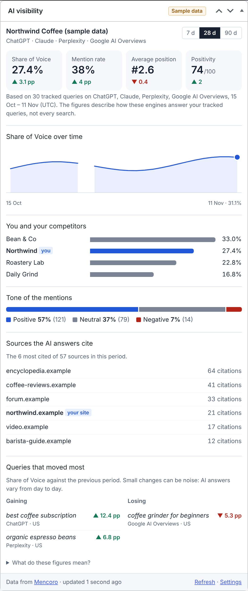
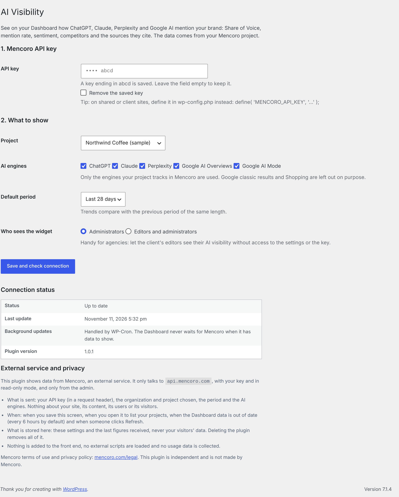

# AI Visibility Dashboard for Mencoro

**See how ChatGPT, Claude, Perplexity and Google AI talk about your brand — right in the WordPress dashboard.**


🇪🇸 **[Leer en español](README.es.md)** · 📖 **[Full documentation](docs/en/README.md)**

A free WordPress plugin that adds an **AI visibility** widget to the Dashboard, fed by your [Mencoro](https://mencoro.com/) project. Generative Engine Optimization (GEO) numbers usually live in a separate tool nobody opens; this puts them where site owners, editors and clients already look every day.

<p align="center"></p>

<sub>Screenshot with fictitious sample data.</sub>

## What it shows

| | |
|---|---|
| **Share of Voice** | Your share of brand mentions in AI answers, against the competitors you track. |
| **Mention rate** | Out of every AI answer checked, how many mention your brand. |
| **Average position** | Where your brand appears inside the answer (lower is better). |
| **Positivity** | Tone of the mentions, 0–100. |
| **Trend** | Share of Voice day by day (week by week over 90 days). |
| **You vs competitors** | Share of Voice side by side. |
| **Tone of mentions** | Positive / neutral / negative split. |
| **Sources the AI cites** | The domains AI answers rely on for your topics — your own site is flagged, and you get a nudge when it is missing. |
| **Queries that moved most** | Tracked prompts gaining and losing Share of Voice. |

Every figure comes with its change against the previous period of the same length (▲ improved, ▼ worse — always shown with a number, never colour alone). Switch between 7, 28 and 90 days from the widget.

Engines: ChatGPT, Claude, Perplexity, Google AI Overviews and Google AI Mode — whichever your Mencoro project tracks. Classic Google results and Shopping are left out on purpose.

## Requirements

- WordPress 6.5 or later, PHP 7.4 or later.
- A Mencoro account with a project and an **API key** (Mencoro → user menu → *API keys*). The `read` capability is enough.

## Install

1. Download the latest release zip (or clone this repository into `wp-content/plugins/ai-visibility-dashboard`).
2. In WordPress, go to **Plugins → Add New → Upload Plugin**, upload the zip and activate it.
3. Go to **Settings → AI Visibility**, paste your API key and click **Save and check connection**.
4. Choose your project, save, and open the **Dashboard**.

<p align="center"></p>

## For agencies

- **Show it to clients without giving them the key.** Under *Who sees the widget*, pick *Editors and administrators*: the client's editors see their AI visibility, but only administrators reach the settings.
- **Keep the key out of the database.** Define it in `wp-config.php` and the field disappears from the settings screen:

  ```php
  define( 'MENCORO_API_KEY', 'mencoro_sk_…' );
  ```

  A `MENCORO_API_KEY` environment variable works too.
- One Mencoro key can read several organizations: the project picker groups projects by organization, so each client site points at its own project.

## Privacy and security

- The plugin only talks to `api.mencoro.com`, with your key, using **read-only** requests. It never creates, changes or deletes anything in Mencoro.
- It sends nothing about your site or your visitors, adds nothing to the front end and loads no external scripts. The widget is rendered on the server: no JavaScript at all.
- The key is never printed back on the page (only its last four characters), and the option that stores it is not autoloaded.
- Results stay fresh for 6 hours (Mencoro checks most queries once a day). A refresh costs 7 API requests.
- **The Dashboard never waits for Mencoro when it has something to show.** Out-of-date figures are shown with their age while one background update (WP-Cron) fetches new ones. If Mencoro is slow or down, the last valid figures stay on screen; the plugin honours `Retry-After` and backs off from 1 to 30 minutes on other errors. Only one update runs at a time.
- Error messages never copy what the API answered, redirects are not followed and every field is type-checked before it is shown.
- Uninstalling removes the settings, the key, the stored figures and scheduled updates, on every site of a network.

## For developers

| Hook / constant | Purpose |
|---|---|
| `MENCORO_API_KEY` (constant or env) | API key, takes precedence over the stored one. |
| `aivd_widget_capability` (filter) | Capability needed to see the widget. Default `manage_options`, or `edit_others_posts` when editors are allowed. |
| `aivd_cache_ttl` (filter) | How long figures stay fresh, in seconds. Default `6 * HOUR_IN_SECONDS`. |
| `aivd_http_timeout` (filter) | Seconds to wait for one response (2–30). Default 10. |
| `aivd_refresh_budget` (filter) | Seconds one update may wait in total: 12 while someone waits for the page, 25 in the background. |
| `aivd_api_base` (filter) / `AIVD_API_BASE` (constant) | API base URL, e.g. to test against a mock server. Must be HTTPS, or HTTP on localhost. |

Endpoints used (all `GET`, see the [Mencoro API docs](https://mencoro.com/api-docs/)): `me`, `organizations`, `projects`, `projects/{id}`, `available-filters`, `metrics`, `timeseries`, `cited-sources`, `metrics/movers`.

Coding standards, PHPCompatibility (PHP 7.4+) and a PHPUnit suite on the WordPress test library run in CI; see [CONTRIBUTING.md](CONTRIBUTING.md). Plugin Check 2.2.0 reports no errors.

## Translations

Bundled: English and Spanish (Spain). The text domain is `ai-visibility-dashboard`; a `.pot` template lives in `languages/`. Pull requests with new languages are welcome.

## License

GPL-2.0-or-later. See [LICENSE](LICENSE).

---

Made by [TrailSEO](https://trailseo.com/). This is an independent plugin built on Mencoro's public API; it is not an official Mencoro product. Mencoro is a trademark of its respective owners.
