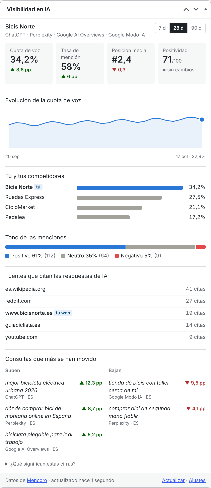

# Cómo leer el widget

[Documentación](README.md) › Cómo leer el widget

El widget responde a una pregunta: **cuando la gente pregunta a los asistentes de IA sobre tus temas, ¿aparece tu marca, dónde y en qué tono?** Esta página explica cada parte, de dónde sale cada número y qué puedes hacer con él.

Todas las cifras vienen de tu proyecto de Mencoro, para los motores de IA que aparecen bajo el nombre del proyecto y el periodo que elijas.

 

## Cabecera

- **Nombre del proyecto** y, debajo, **los motores de IA incluidos**: los marcados en los ajustes que el proyecto sigue de verdad.
- **7 d · 28 d · 90 d** cambia el periodo. La elección solo cambia lo que ves tú en ese momento; el periodo por defecto está en los ajustes.

**Cómo funciona el periodo.** "28 días" son los últimos 28 días UTC, hoy incluido. Cada tendencia compara ese tramo con los 28 días justo anteriores. En 90 días la gráfica agrupa por semanas; si no, por días.

## Las cuatro cifras principales

Cada recuadro muestra el valor y su cambio respecto al periodo anterior de la misma duración:

- **▲ verde**: mejora. **▼ rojo**: empeora. **= sin cambios**.
- *sin periodo anterior*: Mencoro todavía no tiene datos del tramo anterior (lo normal en proyectos nuevos).
- `pp` son **puntos porcentuales**: pasar del 30 % al 33 % es +3 pp, no +10 %.

Pasa el ratón por encima de un recuadro para ver su definición.

### Cuota de voz

Tu parte de las menciones de marca en las respuestas de IA, frente a los competidores que sigues en tu proyecto de Mencoro. **Cuanto más alta, mejor.** Mencoro pondera cada mención en lugar de solo contarlas; su documentación explica la fórmula. Si sigues a tres competidores, la cuota de voz es tu parte de las menciones de esas cuatro marcas: depende de qué competidores sigas.

**Qué hacer con ella:** es la cifra principal para informar y seguir en el tiempo. Si baja mientras la tasa de mención se mantiene, normalmente es que a los competidores los mencionan más, no que a ti te mencionen menos: mira *Tú y tus competidores*.

### Tasa de mención

De todas las respuestas de IA que Mencoro comprobó en el periodo, el porcentaje que menciona tu marca. **Cuanto más alta, mejor.** Si pasas el ratón por encima, verás en cuántas de tus consultas seguidas apareces al menos una vez.

**Qué hacer con ella:** habla de *cobertura*. Una tasa de mención baja con buena cuota de voz significa que dominas unas pocas consultas y no apareces en muchas. Mira en Mencoro qué consultas no te mencionan nunca y decide si necesitas contenido para ellas.

### Posición media

Cuando mencionan tu marca, en qué lugar de la respuesta aparece, de media. `#1` es la primera marca mencionada. **Cuanto más baja, mejor**: por eso la flecha sale ▲ verde cuando el número *baja*.

**Qué hacer con ella:** las respuestas suelen listar varias opciones y ser la primera importa. Si tu posición empeora mientras la de los competidores se mantiene, compara cómo los describen a ellos y a ti (Mencoro guarda los textos de cada mención).

### Positividad

Tono de las menciones, de 0 (todas negativas) a 100 (todas positivas). **Cuanto más alta, mejor.**

**Qué hacer con ella:** una caída brusca merece investigarse pronto. Lee las menciones negativas en Mencoro: muchas veces vienen de una reseña, un hilo de foro o un artículo desactualizado que la IA sigue citando, y que aparece en *Fuentes que citan las respuestas de IA*.

## Evolución de la cuota de voz

Una pequeña gráfica de área con tu cuota de voz por día (por semana en 90 días). Pasa el ratón por cualquier punto para ver su fecha y su valor. El último punto va resaltado, y las fechas y el último valor aparecen escritos debajo.

Un **hueco en la línea** significa que Mencoro no tiene comprobaciones esos días: no se midió nada, que no es lo mismo que cero. *Todavía no hay suficientes días con datos para dibujar la evolución* aparece cuando hay menos de dos días con datos.

## Tú y tus competidores

Tu marca (marcada con **tú**) y hasta cinco competidores, ordenados por cuota de voz. Los nombres de los competidores son los que tengas en Mencoro. Este bloque no aparece si el proyecto no sigue competidores.

## Tono de las menciones

Cuántas de tus menciones fueron positivas, neutras o negativas, en una barra y en números. Azul es positivo, gris neutro y rojo negativo; la leyenda siempre da el porcentaje y la cantidad, así que el color nunca es la única pista.

## Fuentes que citan las respuestas de IA

Los seis dominios que más han citado las respuestas de IA en el periodo, con su número de citas. Son las webs en las que los motores *confían para tus temas*.

- Si una es tu web, aparece marcada como **tu web**. "Tu web" es cualquier dominio configurado en el proyecto de Mencoro, o el dominio de este WordPress (con o sin `www.`).
- Si tu web no está en la lista, un aviso amarillo te lo dice.

**Qué hacer con esto:** suele ser el bloque con más acción.

- **Tu web no aparece:** los motores aprenden sobre tu tema en otros sitios. Conseguir que mencionen tu marca en esos dominios (un artículo, un listado, una comparativa, una cita como experto, una respuesta en una comunidad) suele ser más rápido que esperar a que citen tus páginas.
- **Hay un foro o una comunidad arriba:** las preguntas de la gente ahí dan forma a las respuestas. Estar presente de verdad importa más que los enlaces.
- **Tu web aparece:** averigua qué páginas tuyas se citan (Mencoro puede agrupar las fuentes por página) y mantenlas precisas y al día.

## Consultas que más se han movido

Hasta tres consultas seguidas en cada lado:

- **Suben**: las que más cuota de voz ganan respecto al periodo anterior.
- **Bajan**: las que más pierden.

Cada fila muestra la consulta, el motor y el país donde se comprobó, y el cambio en puntos porcentuales. En *Suben* solo salen subidas reales y en *Bajan* solo bajadas reales: las consultas que no se movieron quedan fuera, así que un lado puede decir *Ninguna en este periodo*.

**Qué hacer con esto:** una consulta que cae mucho en un motor pero no en los demás suele apuntar a un cambio en ese motor (una fuente nueva en la que se apoya, una actualización del modelo). Una consulta que cae en todos suele apuntar a un movimiento de un competidor.

## ¿Qué significan estas cifras?

Un glosario plegable al final del widget repite las definiciones de arriba, para compañeros y clientes que ven el widget sin esta guía.

## Pie

- **Datos de Mencoro · actualizado hace …**: cuándo se trajeron los datos por última vez, no cuándo comprobó Mencoro las respuestas.
- **Actualizar**: trae datos nuevos ahora, para todos. Úsalo después de añadir consultas o competidores en Mencoro.
- **Ajustes**: solo para administradores.

## Otros estados que puedes ver

| Mensaje | Qué significa |
|---|---|
| *¿Cómo hablan de tu marca ChatGPT, Claude, Perplexity y Google IA?* + **Conectar Mencoro** | El plugin aún no está configurado. Los editores ven *Pide a un administrador…* en lugar del botón. |
| *Todavía no se ha comprobado ninguna respuesta de IA en este periodo…* | El proyecto existe pero Mencoro no tiene comprobaciones en este tramo. Normal los primeros días. Prueba con 90 días o vuelve mañana. |
| *Este proyecto de Mencoro todavía no sigue ningún motor de IA…* | El proyecto solo sigue resultados clásicos de Google o Shopping. Añade motores de IA a sus consultas en Mencoro. |
| *Este proyecto no sigue ninguno de los motores de IA elegidos en los ajustes…* | Marcaste motores que el proyecto no usa. Marca otros en los ajustes. |
| *Mencoro está recalculando parte de este periodo…* | Mencoro está reprocesando datos; las cifras aún pueden cambiar un poco. No hay que hacer nada. |
| Un mensaje de error en rojo con **Reintentar** | Mira [Solución de problemas](solucion-de-problemas.md). |

## ¿Cómo de recientes son los datos?

Hay dos capas:

1. **Mencoro** comprueba tus consultas con la frecuencia que tenga configurada tu proyecto; con la frecuencia diaria habitual, los números se mueven una vez al día.
2. **El plugin** guarda lo que trae durante 6 horas y empieza de cero cada día UTC. **Actualizar** se salta la espera.

Por eso actualizar muchas veces al día rara vez muestra algo nuevo; sirve justo después de cambiar algo en Mencoro.
